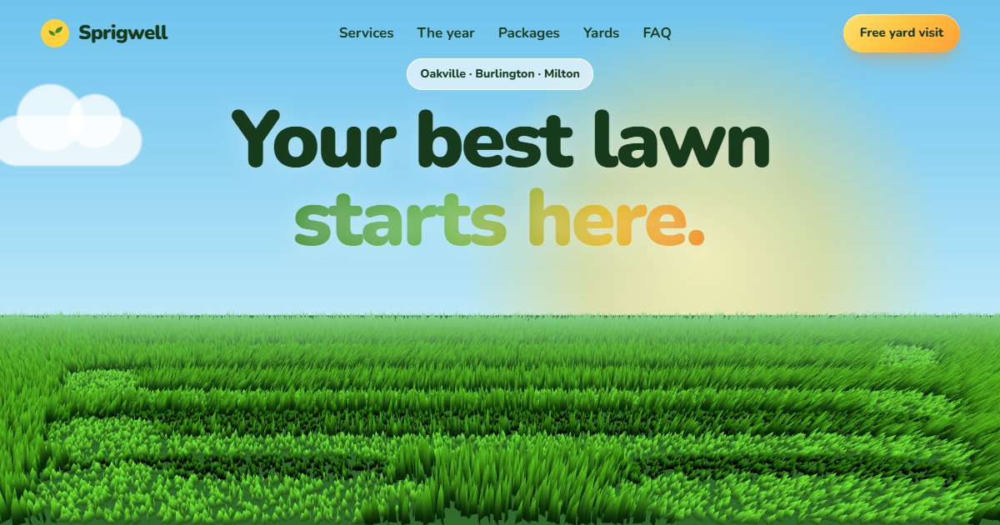

# Sprigwell Lawn & Garden

Website for a lawn care and landscaping company serving Oakville, Burlington and Milton.



## Highlights

- **A lawn you can mow.** The hero is about 110,000 instanced grass blades in plain three.js with custom GLSL shaders and wind. Moving the pointer "mows" the lawn: a small data texture records where the mower has been and which way it went, and the shader shortens those blades and shades them light or dark, like real mowing stripes. A meter tracks how much you've mowed.
- **The growing year.** A pinned, sideways-scrolling year. The sky gradient, sun, tree canopy, flowers, falling leaves and snow all follow the month, and each package is pinned to the month it starts.
- **Package picker.** Choose packages and lawn size and get a yearly total, monthly payment, bundle saving and a month-by-month chart. It shares state with the timeline pins across Astro islands.
- **Free yard visit request.** Day picker with expected-sky icons (wet days become a video call), time slots, interests and contact details, validated with Zod. Ends with a clear "request, not a confirmed appointment".
- Soft gradient surfaces throughout; respects `prefers-reduced-motion`.

## Stack

Astro 7 (static) · React islands · three.js (no wrapper) · Framer Motion · Zod · plain CSS

## Run

```bash
npm install
npm run dev     # http://localhost:5400
npm run build
```

## Structure

```
src/pages/index.astro             page and static sections
src/components/Lawn.tsx           instanced grass, shaders, mowing map
src/components/YearTimeline.tsx   sideways scrolling year with seasonal scenery
src/components/PackagePicker.tsx  packages, lawn size, yearly total and chart
src/components/Booking.tsx        free yard visit request
src/store.ts                      shared plan state between islands
src/data.ts                       packages, services, yards, FAQs
```

## Photo credits

Yard photos from [Unsplash](https://unsplash.com), used under the [Unsplash License](https://unsplash.com/license):
[cedar deck](https://unsplash.com/photos/a-wooden-deck-surrounded-by-rocks-and-trees-XetPrcHCzZg),
[stepping path](https://unsplash.com/photos/lounge-chairs-on-stone-patio-bGaG3Cfp2WA),
[perennial beds](https://unsplash.com/photos/green-garden-with-diverse-plants-a-birdhouse-and-stone-path-iOHMGaLo944),
[granite patio](https://unsplash.com/photos/circular-paved-patio-with-low-stone-wall-and-green-bushes-NvApISBMvXY),
[spa deck](https://unsplash.com/photos/hot-tub-on-a-wooden-deck-surrounded-by-lush-garden-5uq6nHOYRfw),
[family lawn](https://unsplash.com/photos/a-backyard-with-a-deck-and-a-fence-gyOmQE2vzWs).
